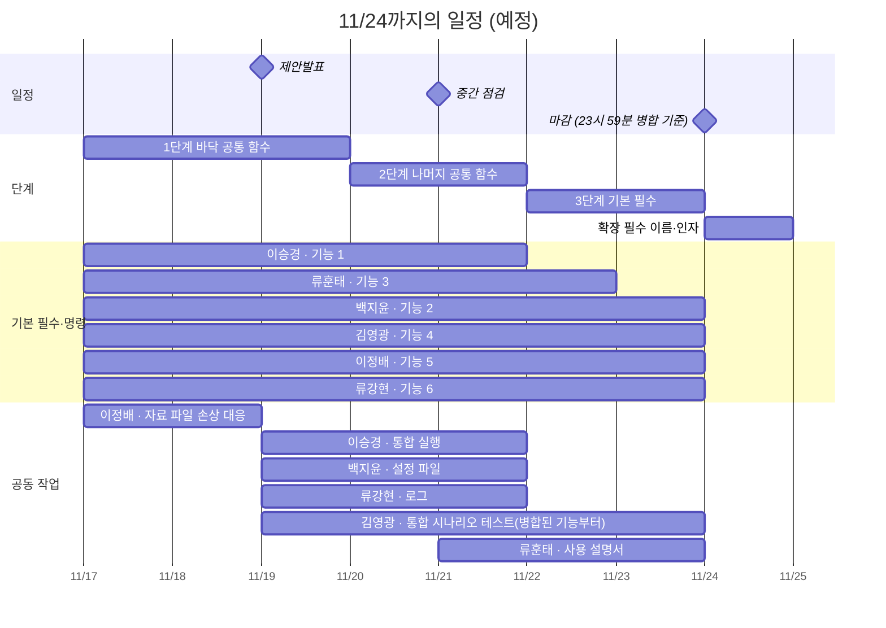
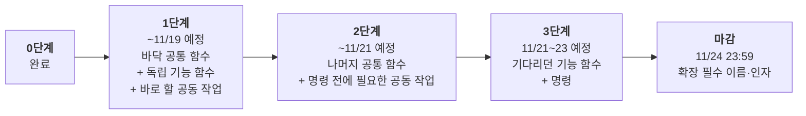

# 2팀 제안발표 — 모임 회비·지출 정산 도구

11/18 기준 · 발표용 요약이며, 기준 문서는 `docs/규격합의_기능별.md` · `docs/협업규칙.md` · `docs/작업방식.md`

## 1. 역할 분담과 작업 순서

### 기능 6개와 팀 공동 작업 6개

| 담당 | 기능 | 공동 작업 (난이도) |
|---|---|---|
| 이승경 | 1. 지출 입력·관리 | 통합 실행 (보통) |
| 백지윤 | 2. 분류 규칙 | 설정 파일 (쉬움~보통) |
| 류훈태 | 3. 월별·기간 보고서 | 사용 설명서 (쉬움, 마감 직전에 몰림) |
| 김영광 | 4. 정산 | 통합 시나리오 테스트 (어려움) |
| 이정배 | 5. 예산·회비 | 자료 파일 손상 대응 (보통) |
| 류강현 | 6. 가져오기·내보내기 | 로그 (쉬움) |

### 담당 배정의 근거

- 한 사람이 기능 하나와 공동 작업 하나를 맡음 — 누가 무엇을 했는지 저장소 이력에 남김
- 이승경 — 관리자로서 저장소 설정을 맡고, 6명의 명령이 모두 거치는 통합 실행(`cli.py`)을 기능 1의 지출·명부 명령과 함께 맞춤
- 백지윤 — 분류 규칙과 함께 발표 자료 준비를 맡아, 공동 작업은 쉬운 설정 파일을 배정
- 류훈태 — 마무리를 빠르게 할 수 있어, 모든 명령이 완성된 뒤 마감 직전에 몰리는 사용 설명서를 배정
- 김영광 — 공통 함수(`is_locked`, `split` 비율)를 먼저 끝내 6개 기능이 다 돌아야 시작하는 통합 시나리오 테스트를 맡음
- 이정배 — 기능 5가 다른 팀원 4명의 공통 함수를 기다리므로, 기다리는 동안 바로 시작할 수 있는 자료 파일 손상 대응을 배정
- 류강현 — 기능 6이 채울 공통 함수가 5개로 가장 많아, 공동 작업은 가장 가벼운 로그(30~50줄)를 배정
- 공동 작업이 다른 기능 파일을 고칠 때는 그 기능 담당의 승인을 받음 (예: 설정 파일의 `load_members_file` → 기능 1 승인)

### 작업 순서 — 기능마다 먼저 완성되어야 하는 다른 팀원의 작업

| 기능 | 완료된 작업 (담당 기능) | 남은 작업 (담당 기능) · 예정 |
|---|---|---|
| 1. 지출 입력·관리 | `is_member_active` (5) · `is_locked`·`weights` 형식 (4) · `textfmt.table` (3) | `duplicates` (6) · 11/19 (PR #56) |
| 2. 분류 규칙 | `expenses_in` (3) | `add_expense`·`insert` (1) · 11/19 (PR #53) |
| 3. 월별·기간 보고서 | `category_totals` (2) · `months_between` (5) | `add_expense`·`insert` (1) · 11/19 / `period_total`·`month_key` (6) · 11/21 (PR #69 · #64) |
| 4. 정산 | `expenses_in`·`person_paid`·`textfmt.table` (3) · `Store.record` (1) · `months_between` (5) | `add_expense`·`insert` (1) · 11/19 (PR #53) |
| 5. 예산·회비 | `category_totals` (2) · `member_shares` (4) · `textfmt.table` (3) | `add_expense`·`insert` (1) · 11/19 / `period_total`·`read_csv_rows` (6) · 11/21 (PR #69 · #71) |
| 6. 가져오기·내보내기 | `expenses_in` (3) · `active_members` (5) · `category_of` (2) | `validate`·`insert` (1) · 11/19 (PR #53) |

가장 큰 병목: `add_expense`·`insert`(1) — 다른 다섯 기능이 모두 기다림 (`expenses_in`(3)은 완료)

## 2. 공통 모듈 함수 규격 합의

합의 문서: `docs/규격합의_기능별.md`

### 함수 규격

| 담당 | 함수 | 받는 값 | 돌려주는 값 | 상태 |
|---|---|---|---|---|
| **1**&nbsp;이승경 | `ledger.validate` | 날짜 · 낸 사람 · 금액 · 참여자 · 비율 | `("YYYY-MM-DD", 원 정수)`, 실패 시 `ValueError` | 확정 · PR #53 |
| | `ledger.insert` | 위 + 메모 · 분류 · 반복 번호 · 이력 종류 | 새 지출 dict | 확정 · PR #53 |
| | `Store.record` | 이력 종류 · 지출 번호 · 바꾸기 전/뒤 dict | 없음 (`history` 에 한 건 추가) | 확정 · 병합 #48 |
| **2**&nbsp;백지윤 | `queries.category_of` | 지출 dict | 분류 이름 (없음 · 빈 문자열 → `"미분류"`) | 확정 · 병합 #39 |
| | `queries.category_totals` | 기간 | `{분류: {"count", "amount"}}` 금액 큰 순 | 확정 · 병합 #39 |
| **3**&nbsp;류훈태 | `queries.expenses_in` | 기간 | 지출 dict 목록, 날짜 → 번호 순 | 확정 · 병합 #40 |
| | `queries.person_paid` | 기간 | `{이름: 낸 돈}` 명부 순서 | 확정 · 병합 #52 |
| | `textfmt.table` | 열 이름 · 줄 목록 · 합계 줄 · 숫자 열 | 표 문자열 (숫자 열은 쉼표·오른쪽 정렬) | 확정 · 병합 #54 |
| | `textfmt.bar_chart` | `{이름: 값}` | 막대 그래프 문자열 (0 이하는 숫자만) | 확정 · 병합 #62 |
| **4**&nbsp;김영광 | `queries.is_locked` | 날짜 | `True` / `False` | 확정 · 병합 #7 |
| | `money.split` 비율 | 금액 · 참여자 · 낸 사람 · `{이름: 정수}` | `{이름: 부담액}`, 합계 = 금액 | 확정 · 병합 #10 |
| | `queries.expense_shares` | 지출 dict | `{이름: 부담액}` members 순서 | 확정 · 병합 #28 |
| | `queries.member_shares` | 기간 | `{이름: 부담액 합}`, 합계 = 기간 합계 | 확정 · 병합 #59 |
| **5**&nbsp;이정배 | `queries.is_member_active` | 이름 · 날짜 | `True` / `False`, 명부에 없으면 `False` | 확정 · 병합 #16 |
| | `queries.active_members` | 날짜 | 그날 회원 이름 목록, 명부 순서 | 확정 · 병합 #29 |
| | `dates.months_between` | `(년, 월)` 2개 | `[(년, 월), …]` 둘 다 포함, 역순이면 `[]` | 확정 · 병합 #34 |
| | `Store.backups` (공동: 손상 대응) | 없음 | 백업 파일 경로 목록, 오래된 순 | 병합 #37 · 규격 확인 대기 |
| | `Store.recover` (공동: 손상 대응) | 없음 | 최신 정상 백업을 불러온 `Store`, 정상 백업이 없으면 `ValueError` | 병합 #37 · 규격 확인 대기 |
| **6**&nbsp;류강현 | `ledger.duplicates` | 날짜 · 낸 사람 · 금액 | 같은 날 · 사람 · 금액인 지출 번호 목록, 번호 오름차순 | 확정 · PR #56 |
| | `queries.period_total` | 기간 | 합계 원 정수 (삭제 제외) | 확정 · PR #69 |
| | `dates.month_key` | 날짜 | `"YYYY-MM"` | 확정 · PR #64 |
| | `csvio.detect_encoding` | 파일 경로 | `"utf-8-sig"` 또는 `"cp949"` | 확정 · 병합 #42 |
| | `csvio.read_csv_rows` | 경로 · 열 이름 대응 · 인코딩 | `(인코딩, [(줄 번호, {필드: 값})])` | 형식 확정 · PR #71 (줄 번호 규칙 확인 대기) |

### 규약 값 예시

| 규약 | 상황 | 결과 |
|---|---|---|
| **나누기** (규약 2절) | **10,000원을 [가, 나, 다]가 나누고 나가 냄** | **가 3,333 · 나 3,334 · 다 3,333** |
| | 10,000원, 라가 냄(참여하지 않음) | 가 3,334 · 나 3,333 · 다 3,333 |
| **기간** (규약 3절) | **11/30 지출, 기간 11/01~11/30** | **포함** (12/01 지출은 불포함) |
| 사사오입 (규약 1절) | 2.5 / 2.4 / "1,234.5원" | 3 / 2 / 1,235 |
| 한 달 (규약 3절) | 2028-02 | 02-01 ~ 02-29 (윤년) |
| 회원 기간 (규약 4절) | 탈퇴일 11/15 | 11/15 참여 가능, 11/16부터 불가 |
| 정산 확정 (규약 6절) | 11/01~11/30 확정 | 11/30 지출 추가 거부 |

나머지 1원: 원 미만은 버리고, 남는 1원은 낸 사람 먼저, 그다음 참여자 목록 순서

### 우리 팀이 정한 값

| 정한 것 | 예 | 정한 사람 |
|---|---|---|
| 비율 분배 | 10,001원, 2:1:1, 나가 냄 → 가 5,000 · 나 2,501 · 다 2,500 | 김영광 11/13 |
| 송금 횟수 줄이기 | 가장 많이 보낼 사람 → 가장 많이 받을 사람, 같으면 명부 순서 | 김영광 11/13 |
| 반복 지출 날짜 | 매달 31일 → 2026년 2월은 2/28 (말일) | 김영광 11/13 |
| 명부에 없는 이름 | 회원 판정 → `False` (오류 아님) | 이정배 11/16 |
| 달 목록 역순 | 시작 > 끝 → `[]` | 이정배 11/16 |
| 미분류 | 분류 없음 · 빈 문자열 · 직접 적은 `"미분류"` → 모두 `"미분류"` | 백지윤 11/15 · 11/17 |
| 분류별 합계 순서 | 식비 30,000 · 교통 10,000 · 간식 10,000 → 식비, 간식, 교통 | 백지윤 11/15 |
| 규칙 우선순위 | 숫자가 클수록 먼저, 같으면 먼저 등록한 규칙 | 백지윤 11/15 |
| 지출 목록 순서 | 날짜 → 번호 순 | 류훈태 11/16 |

## 3. 협업 규칙 합의문

합의문: `docs/협업규칙.md`, `docs/작업방식.md`

### 저장소 규칙

- main 직접 push 금지, 모든 변경은 브랜치 + PR
- 병합 조건: 다른 팀원 1명 이상 승인 + `check` 통과(문법 · import · 팀 테스트)
- force push · main 삭제 금지, merge commit 만 허용, 관리자도 예외 없음

### 브랜치 이름

- `종류/내용` — 예: `feat/is-locked`, `docs/collab-rules`

### 커밋 메시지

- `종류: 한 줄 요약` — 예: `feat: queries.is_locked 구현, store 에 locks 항목 추가`
- 종류: `feat` · `fix` · `test` · `docs` · `refactor` · `chore`

### PR에 적을 내용

- 제목: 커밋 메시지와 같은 형식
- 맨 위 표: 담당 / 바꾼 공통 모듈 / 쓰는 기능 / 남의 담당 부분 수정

| 항목 | PR 설명의 칸 | 예 |
|---|---|---|
| 변경 내용 | 무엇을 바꿨나 | `is_locked` 구현, `EMPTY` 에 `locks` 추가 |
| 변경 이유 | 왜 | 기능 1·6이 확정 기간을 막는 데 필요(규약 6절) |
| 확인 방법 | 검토해 줄 것 + 테스트 | 11/01~11/30 잠금: 11/30 True, 12/01 False |

### 검토자 배정

| 경우 | 검토자 |
|---|---|
| 공통 함수 PR | 그 함수를 쓰는 기능 담당자 |
| 남의 담당 부분을 고친 PR | 원래 담당자(승인 필수) |
| 기능 PR | 다음 번호 기능 담당자 (예시) |

팀원별 검토 대상 (예시)

| 검토하는 사람 | 검토 대상 |
|---|---|
| 백지윤 (기능 2) | 이승경 (기능 1) |
| 류훈태 (기능 3) | 백지윤 (기능 2) |
| 김영광 (기능 4) | 류훈태 (기능 3) |
| 이정배 (기능 5) | 김영광 (기능 4) |
| 류강현 (기능 6) | 이정배 (기능 5) |
| 이승경 (기능 1) | 류강현 (기능 6) |

1인당 다른 사람의 PR 5건 이상 검토

### 검토 확인 항목과 응답 기한

1. 규약 값과 대조 (필수)
2. 함수 이름·인자가 스켈레톤 그대로인가
3. 기능을 추가했으면 테스트가 같은 PR에 있는가
4. 한 PR에 한 가지 변경, 300줄 이하
5. 공통 모듈이면 설명에 무엇·왜·쓰는 기능
6. 담당 표시, 남의 담당 부분은 그 담당자 승인
7. 브랜치 이름 · 커밋 메시지 · PR 표 형식

- 검토 의견에는 확인한 것(대조한 줄, 실행한 명령과 결과)을 적음 — "확인했습니다"만 적은 검토는 건수에서 제외
- 고칠 점이 있으면 Request changes
- 응답 기한: **3시간**, 밤 12시~아침 9시에 받은 요청은 **그날 낮 12시까지**
- 못 지키면 미리 알리고, 연락이 안 되면 관리자(김영광 · 이승경)에게

### 충돌 처리 순서

1. PR 작성자가 자기 브랜치에서 `git pull origin main`
2. 충돌 파일 수정 — **남의 변경은 지우지 않음**, 모르면 쓴 사람에게 문의
3. `git add` → `git commit` → `git push` (PR에 자동 반영)
4. `check` 통과 후 다시 검토 요청
5. 잘못 병합된 것은 `git revert` (force push 금지)

예방: 작업 전 main 받기 · 고칠 공통 모듈 파일은 단톡방에 알림 · `store.py` 항목 추가는 작은 PR로 먼저

## 4. 저장소 기록

저장소: https://github.com/like-people/HI_PJ

### main 보호 규칙

https://github.com/like-people/HI_PJ/rules/27011222

| 규칙 | 뜻 |
|---|---|
| Restrict deletions | main 삭제 금지 |
| Block force pushes | force push 금지 |
| Require a pull request before merging | PR로만 병합, 승인 1명, merge 방식만 |
| Require status checks to pass (`check`) | 검사 통과해야 병합 |
| Bypass list 없음 | 관리자도 예외 없음 |

### 병합된 PR과 검토 의견

**PR #16 `feat: 회원 기간 확인 공통 함수 구현`** — https://github.com/like-people/HI_PJ/pull/16

1. Request changes — 테스트 누락, PR 설명에 이유·쓰는 기능 누락, 코드는 규약 4절과 일치
2. 수정 — PR 설명 보강, 경계값 테스트 6개 추가
3. Approve → `check` 통과 → 병합

### 팀원 6명의 커밋 · 검토 기록 (11/18, 커밋은 main 기준 병합 커밋 제외)

| 팀원 | 커밋 | 검토한 PR | 링크 |
|---|---|---|---|
| 김영광 | 19 | 35건 — #11 #12 #16 #17 #18 #21 #22 #23 #27 #29 #30 #33 #34 #37 #39 #40 #41 #43 #48 #51 #52 #53 #54 #57 #58 #60 #61 #62 #63 #64 #65 #68 #69 #70 #71 | [커밋](https://github.com/like-people/HI_PJ/commits?author=dudrhkd) · [검토](https://github.com/like-people/HI_PJ/pulls?q=is%3Apr+reviewed-by%3Adudrhkd) |
| 이승경 | 15 | 16건 — #1 ~ #10 #28 #32 #35 #37 #42 #51 | [커밋](https://github.com/like-people/HI_PJ/commits?author=seolbinga) · [검토](https://github.com/like-people/HI_PJ/pulls?q=is%3Apr+reviewed-by%3Aseolbinga) |
| 백지윤 | 20 | 6건 — #22 #35 #42 #53 #56 #65 | [커밋](https://github.com/like-people/HI_PJ/commits?author=zyunn205) · [검토](https://github.com/like-people/HI_PJ/pulls?q=is%3Apr+reviewed-by%3Azyunn205) |
| 류훈태 | 15 | 2건 — #13 #47 | [커밋](https://github.com/like-people/HI_PJ/commits?author=fbgnsxo123) · [검토](https://github.com/like-people/HI_PJ/pulls?q=is%3Apr+reviewed-by%3Afbgnsxo123) |
| 이정배 | 16 | 14건 — #9 #10 #19 #20 #21 #28 #38 #39 #44 #45 #46 #49 #50 #59 | [커밋](https://github.com/like-people/HI_PJ/commits?author=Bae087-prog) · [검토](https://github.com/like-people/HI_PJ/pulls?q=is%3Apr+reviewed-by%3ABae087-prog) |
| 류강현 | 9 | 6건 — #9 #21 #22 #29 #35 #61 | [PR](https://github.com/like-people/HI_PJ/pulls?q=is%3Apr+author%3Aryujusun0803-source) · [검토](https://github.com/like-people/HI_PJ/pulls?q=is%3Apr+reviewed-by%3Aryujusun0803-source) |

## 5. 11/24까지의 계획

완성되는 대로 PR로 병합, 날짜는 **늦어도 병합할 기한**
마감 **11/24(화) 23:59 병합 기준** → 검토·승인 시간을 두고 하루 이틀 앞당김

### 일정

기본 필수 4개와 명령 병합: **이승경 11/21 예정 · 류훈태 11/22 예정 · 백지윤 · 김영광 · 이정배 · 류강현 11/23 예정**

### 병합 순서

| 단계 | 공통 함수 (담당 기능) | 함께 병합할 것 | 기다리는 기능 | 병합 |
|---|---|---|---|---|
| 0 | `is_locked`(4), `split` 비율(4), `is_member_active`(5) | | 1, 6 | 완료 |
| 1 | `validate`·`insert`·`Store.record`(1), `expenses_in`(3), `duplicates`(6) | 기능 함수 `add_expense`(1, 다른 기능 테스트용) · 공동: 손상 대응 | 1~6 전부 | 11/19 예정 — `Store.record` · `expenses_in` · 손상 대응 완료, `validate`·`insert` #53 · `duplicates` #56 검토 중, `add_expense` 남음 |
| 2 | `category_of`·`category_totals`(2), `person_paid`·`textfmt.table`·`textfmt.bar_chart`(3), `expense_shares`·`member_shares`(4), `active_members`·`months_between`(5), `period_total`·`read_csv_rows`·`detect_encoding`·`month_key`(6) | 공동: 통합 실행 · 설정 파일 · 로그 | 3, 4, 5, 6 | 11/21 예정 — 공통 함수 13개 중 10개 완료, `period_total` #69 · `month_key` #64 · `read_csv_rows` #71 검토 중 / 설정 파일 완료, 통합 실행 오류 처리 완료(`init` 남음), 로그 #68 · #70 검토 중 |
| 3 | — | 기본 필수 4개와 명령 · 공동: 사용 설명서 · 통합 시나리오 | — | 11/21~23 예정 |
| 마감 | 확장 필수 공통 함수·자료 항목의 이름·인자 | | — | 11/24 |

### 11/18 현재 진행

| 담당 | 완료 (병합) | 검토 중인 PR | 남은 것 (기본 필수·명령) |
|---|---|---|---|
| **1**&nbsp;이승경 | `Store.record` #48 · 통합 실행 오류 처리 #45 | `validate`·`insert` #53 | `add_expense` · 목록 · 수정 · 삭제 · `exp` 명령 |
| **2**&nbsp;백지윤 | 분류 기능 전부 #43 · `category_of`·`category_totals` #39 · `cat` 명령 #58 · 설정 파일 #46 · 명부 파일 읽기 #57 | — | 기본 필수 완료 |
| **3**&nbsp;류훈태 | `expenses_in` #40 · `person_paid` #52 · `table` #54 · `bar_chart` #62 · `monthly_totals`·`period_summary` #63 | 전월 대비·요일별·주별 #65 | `report` 명령 |
| **4**&nbsp;김영광 | `is_locked` #7 · `split` 비율 #10 · `expense_shares` #28 · `member_shares` #59 · `balance_sum` #49 | `balances` #66 | `settle` 명령 |
| **5**&nbsp;이정배 | `is_member_active` #16 · `active_members` #29 · `months_between` #34 · 손상 대응 #37 · `payments` 항목 #41 | `record_payment` #55 · `unpaid` #61 | `month_status` · `treasury_balance` · `budget` 명령 |
| **6**&nbsp;류강현 | `detect_encoding` #42 | `duplicates` #56 · `month_key` #64 · `period_total` #69 · `read_csv_rows` #71 · 로그 #68·#70 | 내보내기(CSV·JSON) · 합계 검사 · `io` 명령 |

### 작업 순서도 — 사람별 단계

| 기능&nbsp;담당 | 1단계 ~11/19 예정 | 2단계 ~11/21 예정 | 3단계 11/21~23 예정 (기다리는 것) |
|---|---|---|---|
| **1**&nbsp;이승경 | 공통: `validate` `insert` `Store.record` 기능: `add_expense`(다른 기능 테스트용) | 기능: 명부 · 목록 · 수정 · 삭제 · 이력 **공동: 통합 실행** — `cli.py` 오류 안내 · `init` | **~11/21 예정** · 기능: `add_expense` 경고 · `add_from_file` (`duplicates` 6, `textfmt.table` 3) |
| **2**&nbsp;백지윤 | 기능: 규칙 읽기·저장·추가·삭제 · `classify` · `overlaps` | 공통: `category_of` `category_totals` **공동: 설정 파일** — 경로 항목 · 명부 파일 읽기 | **~11/23 예정** · 기능: `apply_rules` · `uncategorized` · `summary` (`expenses_in` 3) |
| **3**&nbsp;류훈태 | 공통: `expenses_in` 기능: 월별 · 요일별 · 주별 합계 · `top` · `search` | 공통: `person_paid` `textfmt.table` `textfmt.bar_chart` | **~11/22 예정** · 기능: `period_summary` · `month_report` (`category_totals` 2, `period_total` 6, `months_between` 5, `month_key` 6) **공동: 사용 설명서** — 병합된 명령부터 추가 |
| **4**&nbsp;김영광 | 기능: `lock_period` · `minimal_transfers` · `compare` · `record_transfer` | 공통: `expense_shares` `member_shares` | **~11/23 예정** · 기능: `balances` · `statement` · `exclude_member` · `run_recurring` (`expenses_in`·`person_paid`·`textfmt.table` 3, `insert`·`Store.record` 1, `months_between` 5) **공동: 통합 시나리오 테스트** — 기능이 병합될 때마다 확인 |
| **5**&nbsp;이정배 | 기능: `record_payment` · `unpaid` · `dues_deduction` **공동: 자료 파일 손상 대응** — 안전 저장 · 백업 · 복구 | 공통: `active_members` `months_between` | **~11/23 예정** · 기능: 예산 상태 · 예측 · 예산 표 · 은행 가져오기 (`category_totals` 2, `period_total`·`read_csv_rows` 6, `member_shares` 4, `expenses_in` 3, `category_of` 2, `expense_shares` 4, `insert` 1, `textfmt.table` 3) |
| **6**&nbsp;류강현 | 공통: `duplicates` 기능: `file_total` · `backup_all` · `restore_all` | 공통: `period_total` `read_csv_rows` `detect_encoding` `month_key` **공동: 로그** — 날짜별 로그 파일 | **~11/23 예정** · 기능: 내보내기 · 검증 · `import_csv` · `merge` (`validate`·`insert` 1, `expenses_in` 3, `active_members` 5, `category_of` 2) |

모든 기능: 3단계에서 각자 명령(`moim/commands`)까지 병합

### 예상 위험과 대응

| 위험 | 대응 |
|---|---|
| 팀원 작업 지연·불참 | 11/21 중간 점검 / 지연 시 단톡방에 알리고 다른 기능이 기다리는 작업부터 대체 담당 지정 / 연락이 안 되면 관리자(김영광·이승경) |
| 같은 공통 모듈 파일 동시 수정 | `store.py` 항목 추가는 작은 PR로 먼저 / 작업 전 main 받기, 고칠 파일은 단톡방에 알림 / 충돌 시 남의 변경을 지우지 않고 쓴 사람에게 문의 |
