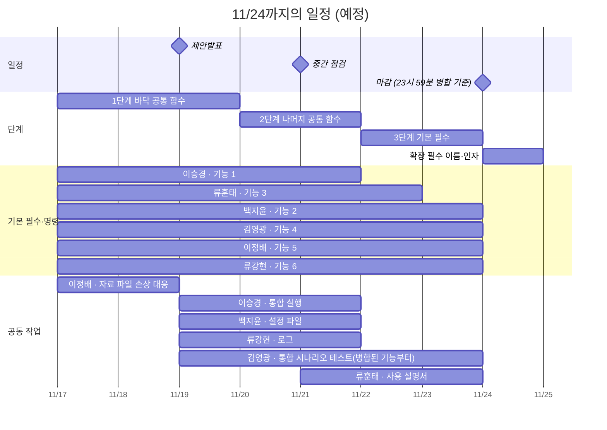
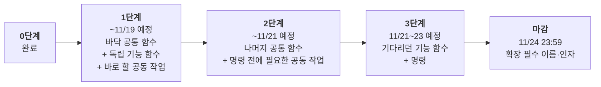

# 2팀 제안발표 — 모임 회비·지출 정산 도구

11/19 기준 · 발표용 요약이며, 기준 문서는 `docs/규격합의_기능별.md` · `docs/협업규칙.md` · `docs/작업방식.md`

## 1. 역할 분담과 작업 순서

### 기능 6개와 팀 공동 작업 6개

| 담⁠당 | 기⁠능 | 공⁠동 작⁠업 (난⁠이⁠도) |
|---|---|---|
| 이⁠승⁠경 | 1. 지⁠출 입⁠력·관⁠리 | 통⁠합 실⁠행 (보⁠통) |
| 백⁠지⁠윤 | 2. 분⁠류 규⁠칙 | 설⁠정 파⁠일 (쉬⁠움~보⁠통) |
| 류⁠훈⁠태 | 3. 월⁠별·기⁠간 보⁠고⁠서 | 사⁠용 설⁠명⁠서 (쉬⁠움, 마⁠감 직⁠전⁠에 몰⁠림) |
| 김⁠영⁠광 | 4. 정⁠산 | 통⁠합 시⁠나⁠리⁠오 테⁠스⁠트 (어⁠려⁠움) |
| 이⁠정⁠배 | 5. 예⁠산·회⁠비 | 자⁠료 파⁠일 손⁠상 대⁠응 (보⁠통) |
| 류⁠강⁠현 | 6. 가⁠져⁠오⁠기·내⁠보⁠내⁠기 | 로⁠그 (쉬⁠움) |

### 담당 배정의 근거

- 한 사람이 기능 하나와 공동 작업 하나를 맡음 — 누가 무엇을 했는지 저장소 이력에 남김
- 이승경 — 관리자로서 저장소 설정을 맡고, 6명의 명령이 모두 거치는 통합 실행(`cli.py`)을 기능 1의 지출·명부 명령과 함께 맞춤
- 백지윤 — 분류 규칙과 함께 발표 자료 준비를 맡아, 공동 작업은 쉬운 설정 파일을 배정
- 류훈태 — 마무리를 빠르게 할 수 있어, 모든 명령이 완성된 뒤 마감 직전에 몰리는 사용 설명서를 배정
- 김영광 — 공통 함수(`is_locked`, `split` 비율)를 먼저 끝내 6개 기능이 다 돌아야 시작하는 통합 시나리오 테스트를 맡음
- 이정배 — 기능 5가 다른 팀원 4명의 공통 함수를 기다리므로, 기다리는 동안 바로 시작할 수 있는 자료 파일 손상 대응을 배정
- 류강현 — 기능 6이 채울 공통 함수가 5개로 가장 많아, 공동 작업은 가장 가벼운 로그(30~50줄)를 배정
- 공동 작업이 다른 기능 파일을 고칠 때는 그 기능 담당의 승인을 받음 (예: 설정 파일의 `load_members_file` → 기능 1 승인)

### 작업 순서 — 기능마다 먼저 완성되어야 하는 다른 팀원의 작업

| 기⁠능 | 먼⁠저 필⁠요⁠한 작⁠업 — 완⁠료 (담⁠당 기⁠능) | 먼⁠저 필⁠요⁠한 작⁠업 — 남⁠은 것 (담⁠당 기⁠능) · 완⁠성 예⁠정⁠일 |
|---|---|---|
| 1. 지⁠출 입⁠력·관⁠리 | `is_member_active` (5) · `is_locked`·`weights` 형⁠식 (4) · `textfmt.table` (3) | `duplicates` (6) · 11/19 (PR #56) |
| 2. 분⁠류 규⁠칙 | `expenses_in` (3) | `add_expense`·`insert` (1) · 11/19 (PR #53) |
| 3. 월⁠별·기⁠간 보⁠고⁠서 | `category_totals` (2) · `months_between` (5) · `period_total`·`month_key` (6) | `add_expense`·`insert` (1) · 11/19 (PR #53) |
| 4. 정⁠산 | `expenses_in`·`person_paid`·`textfmt.table` (3) · `Store.record` (1) · `months_between` (5) | `add_expense`·`insert` (1) · 11/19 (PR #53) |
| 5. 예⁠산·회⁠비 | `category_totals` (2) · `member_shares` (4) · `textfmt.table` (3) · `period_total` (6) | `add_expense`·`insert` (1) · 11/19 (PR #53) / `read_csv_rows` (6) · 11/21 (PR #71) |
| 6. 가⁠져⁠오⁠기·내⁠보⁠내⁠기 | `expenses_in` (3) · `active_members` (5) · `category_of` (2) | `validate`·`insert` (1) · 11/19 (PR #53) |

가장 큰 병목: `add_expense`·`insert`(1) — 다른 다섯 기능이 모두 기다림 (`expenses_in`(3)은 완료)

## 2. 공통 모듈 함수 규격 합의

합의 문서: `docs/규격합의_기능별.md`

### 함수 규격

| 담⁠당 | 함⁠수 | 받⁠는 값 | 돌⁠려⁠주⁠는 값 | 상⁠태 |
|---|---|---|---|---|
| **1**&nbsp;이⁠승⁠경 | `ledger.validate` | 날⁠짜 · 낸 사⁠람 · 금⁠액 · 참⁠여⁠자 · 비⁠율 | `("YYYY-MM-DD", 원 정⁠수)`, 실⁠패 시 `ValueError` | 확⁠정 · PR #53 (승⁠인⁠됨) |
| | `ledger.insert` | 위 + 메⁠모 · 분⁠류 · 반⁠복 번⁠호 · 이⁠력 종⁠류 | 새 지⁠출 dict | 확⁠정 · PR #53 (승⁠인⁠됨) |
| | `Store.record` | 이⁠력 종⁠류 · 지⁠출 번⁠호 · 바⁠꾸⁠기 전/뒤 dict | 없⁠음 (`history` 에 한 건 추⁠가) | 확⁠정 · 병⁠합 #48 |
| **2**&nbsp;백⁠지⁠윤 | `queries.category_of` | 지⁠출 dict | 분⁠류 이⁠름 (없⁠음 · 빈 문⁠자⁠열 → `"미⁠분⁠류"`) | 확⁠정 · 병⁠합 #39 |
| | `queries.category_totals` | 기⁠간 | `{분⁠류: {"count", "amount"}}` 금⁠액 큰 순 | 확⁠정 · 병⁠합 #39 |
| **3**&nbsp;류⁠훈⁠태 | `queries.expenses_in` | 기⁠간 | 지⁠출 dict 목⁠록, 날⁠짜 → 번⁠호 순 | 확⁠정 · 병⁠합 #40 |
| | `queries.person_paid` | 기⁠간 | `{이⁠름: 낸 돈}` 명⁠부 순⁠서 | 확⁠정 · 병⁠합 #52 |
| | `textfmt.table` | 열 이⁠름 · 줄 목⁠록 · 합⁠계 줄 · 숫⁠자 열 | 표 문⁠자⁠열 (숫⁠자 열⁠은 쉼⁠표·오⁠른⁠쪽 정⁠렬) | 확⁠정 · 병⁠합 #54 |
| | `textfmt.bar_chart` | `{이⁠름: 값}` | 막⁠대 그⁠래⁠프 문⁠자⁠열 (0 이⁠하⁠는 숫⁠자⁠만) | 확⁠정 · 병⁠합 #62 |
| **4**&nbsp;김⁠영⁠광 | `queries.is_locked` | 날⁠짜 | `True` / `False` | 확⁠정 · 병⁠합 #7 |
| | `money.split` 비⁠율 | 금⁠액 · 참⁠여⁠자 · 낸 사⁠람 · `{이⁠름: 정⁠수}` | `{이⁠름: 부⁠담⁠액}`, 합⁠계 = 금⁠액 | 확⁠정 · 병⁠합 #10 |
| | `queries.expense_shares` | 지⁠출 dict | `{이⁠름: 부⁠담⁠액}` members 순⁠서 | 확⁠정 · 병⁠합 #28 |
| | `queries.member_shares` | 기⁠간 | `{이⁠름: 부⁠담⁠액 합}`, 합⁠계 = 기⁠간 합⁠계 | 확⁠정 · 병⁠합 #59 |
| **5**&nbsp;이⁠정⁠배 | `queries.is_member_active` | 이⁠름 · 날⁠짜 | `True` / `False`, 명⁠부⁠에 없⁠으⁠면 `False` | 확⁠정 · 병⁠합 #16 |
| | `queries.active_members` | 날⁠짜 | 그⁠날 회⁠원 이⁠름 목⁠록, 명⁠부 순⁠서 | 확⁠정 · 병⁠합 #29 |
| | `dates.months_between` | `(년, 월)` 2개 | `[(년, 월), …]` 둘 다 포⁠함, 역⁠순⁠이⁠면 `[]` | 확⁠정 · 병⁠합 #34 |
| | `Store.backups` (공⁠동: 손⁠상 대⁠응) | 없⁠음 | 백⁠업 파⁠일 경⁠로 목⁠록, 오⁠래⁠된 순 | 병⁠합 #37 · 규⁠격 확⁠인 대⁠기 |
| | `Store.recover` (공⁠동: 손⁠상 대⁠응) | 없⁠음 | 최⁠신 정⁠상 백⁠업⁠을 불⁠러⁠온 `Store`, 정⁠상 백⁠업⁠이 없⁠으⁠면 `ValueError` | 병⁠합 #37 · 규⁠격 확⁠인 대⁠기 |
| **6**&nbsp;류⁠강⁠현 | `ledger.duplicates` | 날⁠짜 · 낸 사⁠람 · 금⁠액 | 같⁠은 날 · 사⁠람 · 금⁠액⁠인 지⁠출 번⁠호 목⁠록, 번⁠호 오⁠름⁠차⁠순 | 확⁠정 · PR #56 |
| | `queries.period_total` | 기⁠간 | 합⁠계 원 정⁠수 (삭⁠제 제⁠외) | 확⁠정 · 병⁠합 #69 |
| | `dates.month_key` | 날⁠짜 | `"YYYY-MM"` | 확⁠정 · 병⁠합 #64 |
| | `csvio.detect_encoding` | 파⁠일 경⁠로 | `"utf-8-sig"` 또⁠는 `"cp949"` | 확⁠정 · 병⁠합 #42 |
| | `csvio.read_csv_rows` | 경⁠로 · 열 이⁠름 대⁠응 · 인⁠코⁠딩 | `(인⁠코⁠딩, [(줄 번⁠호, {필⁠드: 값})])` | 형⁠식 확⁠정 · PR #71 (줄 번⁠호 규⁠칙 확⁠인 대⁠기) |

### 규약 값 예시

| 규⁠약 | 상⁠황 | 결⁠과 |
|---|---|---|
| **나⁠누⁠기** (규⁠약 2절) | **10,000원⁠을 [가, 나, 다]가 나⁠누⁠고 나⁠가 냄** | **가 3,333 · 나 3,334 · 다 3,333** |
| | 10,000원, 라⁠가 냄(참⁠여⁠하⁠지 않⁠음) | 가 3,334 · 나 3,333 · 다 3,333 |
| **기⁠간** (규⁠약 3절) | **11/30 지⁠출, 기⁠간 11/01~11/30** | **포⁠함** (12/01 지⁠출⁠은 불⁠포⁠함) |
| 사⁠사⁠오⁠입 (규⁠약 1절) | 2.5 / 2.4 / "1,234.5원" | 3 / 2 / 1,235 |
| 한 달 (규⁠약 3절) | 2028-02 | 02-01 ~ 02-29 (윤⁠년) |
| 회⁠원 기⁠간 (규⁠약 4절) | 탈⁠퇴⁠일 11/15 | 11/15 참⁠여 가⁠능, 11/16부⁠터 불⁠가 |
| 정⁠산 확⁠정 (규⁠약 6절) | 11/01~11/30 확⁠정 | 11/30 지⁠출 추⁠가 거⁠부 |

나머지 1원: 원 미만은 버리고, 남는 1원은 낸 사람 먼저, 그다음 참여자 목록 순서

### 우리 팀이 정한 값

| 정⁠한 것 | 예 | 정⁠한 사⁠람 |
|---|---|---|
| 비⁠율 분⁠배 | 10,001원, 2:1:1, 나⁠가 냄 → 가 5,000 · 나 2,501 · 다 2,500 | 김⁠영⁠광 11/13 |
| 송⁠금 횟⁠수 줄⁠이⁠기 | 가⁠장 많⁠이 보⁠낼 사⁠람 → 가⁠장 많⁠이 받⁠을 사⁠람, 같⁠으⁠면 명⁠부 순⁠서 | 김⁠영⁠광 11/13 |
| 반⁠복 지⁠출 날⁠짜 | 매⁠달 31일 → 2026년 2월⁠은 2/28 (말⁠일) | 김⁠영⁠광 11/13 |
| 명⁠부⁠에 없⁠는 이⁠름 | 회⁠원 판⁠정 → `False` (오⁠류 아⁠님) | 이⁠정⁠배 11/16 |
| 달 목⁠록 역⁠순 | 시⁠작 > 끝 → `[]` | 이⁠정⁠배 11/16 |
| 미⁠분⁠류 | 분⁠류 없⁠음 · 빈 문⁠자⁠열 · 직⁠접 적⁠은 `"미⁠분⁠류"` → 모⁠두 `"미⁠분⁠류"` | 백⁠지⁠윤 11/15 · 11/17 |
| 분⁠류⁠별 합⁠계 순⁠서 | 식⁠비 30,000 · 교⁠통 10,000 · 간⁠식 10,000 → 식⁠비, 간⁠식, 교⁠통 | 백⁠지⁠윤 11/15 |
| 규⁠칙 우⁠선⁠순⁠위 | 숫⁠자⁠가 클⁠수⁠록 먼⁠저, 같⁠으⁠면 먼⁠저 등⁠록⁠한 규⁠칙 | 백⁠지⁠윤 11/15 |
| 지⁠출 목⁠록 순⁠서 | 날⁠짜 → 번⁠호 순 | 류⁠훈⁠태 11/16 |

## 3. 협업 규칙 합의문

합의문: `docs/협업규칙.md`, `docs/작업방식.md`

### 저장소 규칙

- main 직접 push 금지, 모든 변경은 브랜치 + PR
- 병합 조건: 다른 팀원 1명 이상 승인 + `check` 통과(문법 · import · 팀 테스트)
- force push · main 삭제 금지, merge commit 만 허용, 관리자도 예외 없음

### 브랜치 이름

- `종류/내용` — 예: `feat/is-locked`, `docs/collab-rules`

### 커밋 메시지

- `종류: 한 줄 요약` — 예: `feat: queries.is_locked 구현, store 에 locks 항목 추가`
- 종류: `feat` · `fix` · `test` · `docs` · `refactor` · `chore`

### PR에 적을 내용

- 제목: 커밋 메시지와 같은 형식
- 맨 위 표: 담당 / 바꾼 공통 모듈 / 쓰는 기능 / 남의 담당 부분 수정

| 항⁠목 | PR 설⁠명⁠의 칸 | 예 |
|---|---|---|
| 변⁠경 내⁠용 | 무⁠엇⁠을 바⁠꿨⁠나 | `is_locked` 구⁠현, `EMPTY` 에 `locks` 추⁠가 |
| 변⁠경 이⁠유 | 왜 | 기⁠능 1·6이 확⁠정 기⁠간⁠을 막⁠는 데 필⁠요(규⁠약 6절) |
| 확⁠인 방⁠법 | 검⁠토⁠해 줄 것 + 테⁠스⁠트 | 11/01~11/30 잠⁠금: 11/30 True, 12/01 False |

### 검토자 배정

| 경⁠우 | 검⁠토⁠자 |
|---|---|
| 공⁠통 함⁠수 PR | 그 함⁠수⁠를 쓰⁠는 기⁠능 담⁠당⁠자 |
| 남⁠의 담⁠당 부⁠분⁠을 고⁠친 PR | 원⁠래 담⁠당⁠자(승⁠인 필⁠수) |
| 기⁠능 PR | 다⁠음 번⁠호 기⁠능 담⁠당⁠자 (예⁠시) |

팀원별 검토 대상 (예시)

| 검⁠토⁠하⁠는 사⁠람 | 검⁠토 대⁠상 |
|---|---|
| 백⁠지⁠윤 (기⁠능 2) | 이⁠승⁠경 (기⁠능 1) |
| 류⁠훈⁠태 (기⁠능 3) | 백⁠지⁠윤 (기⁠능 2) |
| 김⁠영⁠광 (기⁠능 4) | 류⁠훈⁠태 (기⁠능 3) |
| 이⁠정⁠배 (기⁠능 5) | 김⁠영⁠광 (기⁠능 4) |
| 류⁠강⁠현 (기⁠능 6) | 이⁠정⁠배 (기⁠능 5) |
| 이⁠승⁠경 (기⁠능 1) | 류⁠강⁠현 (기⁠능 6) |

1인당 다른 사람의 PR 5건 이상 검토

### 검토 확인 항목과 응답 기한

1. 규약 값과 대조 (필수)
2. 함수 이름·인자가 스켈레톤 그대로인가
3. 기능을 추가했으면 테스트가 같은 PR에 있는가
4. 한 PR에 한 가지 변경, 300줄 이하
5. 공통 모듈이면 설명에 무엇·왜·쓰는 기능
6. 담당 표시, 남의 담당 부분은 그 담당자 승인
7. 브랜치 이름 · 커밋 메시지 · PR 표 형식

- 검토 의견에는 확인한 것(대조한 줄, 실행한 명령과 결과)을 적음 — "확인했습니다"만 적은 검토는 건수에서 제외
- 고칠 점이 있으면 Request changes
- 응답 기한: **3시간**, 밤 12시~아침 9시에 받은 요청은 **그날 낮 12시까지**
- 못 지키면 미리 알리고, 연락이 안 되면 관리자(김영광 · 이승경)에게

### 충돌 처리 순서

1. PR 작성자가 자기 브랜치에서 `git pull origin main`
2. 충돌 파일 수정 — **남의 변경은 지우지 않음**, 모르면 쓴 사람에게 문의
3. `git add` → `git commit` → `git push` (PR에 자동 반영)
4. `check` 통과 후 다시 검토 요청
5. 잘못 병합된 것은 `git revert` (force push 금지)

예방: 작업 전 main 받기 · 고칠 공통 모듈 파일은 단톡방에 알림 · `store.py` 항목 추가는 작은 PR로 먼저

## 4. 저장소 기록

저장소: https://github.com/like-people/HI_PJ

### main 보호 규칙

https://github.com/like-people/HI_PJ/rules/27011222

| 규⁠칙 | 뜻 |
|---|---|
| Restrict deletions | main 삭⁠제 금⁠지 |
| Block force pushes | force push 금⁠지 |
| Require a pull request before merging | PR로⁠만 병⁠합, 승⁠인 1명, merge 방⁠식⁠만 |
| Require status checks to pass (`check`) | 검⁠사 통⁠과⁠해⁠야 병⁠합 |
| Bypass list 없⁠음 | 관⁠리⁠자⁠도 예⁠외 없⁠음 |

### 병합된 PR과 검토 의견

**PR #16 `feat: 회원 기간 확인 공통 함수 구현`** — https://github.com/like-people/HI_PJ/pull/16

1. Request changes — 테스트 누락, PR 설명에 이유·쓰는 기능 누락, 코드는 규약 4절과 일치
2. 수정 — PR 설명 보강, 경계값 테스트 6개 추가
3. Approve → `check` 통과 → 병합

### 팀원 6명의 커밋 · 검토 기록 (11/19, 커밋은 main 기준 병합 커밋 제외)

| 팀⁠원 | 커⁠밋 | 검⁠토⁠한 PR | 링⁠크 |
|---|---|---|---|
| 김⁠영⁠광 | 24 | 37건 — #11 #12 #16 #17 #18 #21 #22 #23 #27 #29 #30 #33 #34 #37 #39 #40 #41 #43 #48 #51 #52 #53 #54 #57 #58 #60 #61 #62 #63 #64 #65 #68 #69 #70 #71 #72 #73 | [커⁠밋](https://github.com/like-people/HI_PJ/commits?author=dudrhkd) · [검⁠토](https://github.com/like-people/HI_PJ/pulls?q=is%3Apr+reviewed-by%3Adudrhkd) |
| 이⁠승⁠경 | 15 | 16건 — #1 ~ #10 #28 #32 #35 #37 #42 #51 | [커⁠밋](https://github.com/like-people/HI_PJ/commits?author=seolbinga) · [검⁠토](https://github.com/like-people/HI_PJ/pulls?q=is%3Apr+reviewed-by%3Aseolbinga) |
| 백⁠지⁠윤 | 20 | 6건 — #22 #35 #42 #53 #56 #65 | [커⁠밋](https://github.com/like-people/HI_PJ/commits?author=zyunn205) · [검⁠토](https://github.com/like-people/HI_PJ/pulls?q=is%3Apr+reviewed-by%3Azyunn205) |
| 류⁠훈⁠태 | 15 | 2건 — #13 #47 | [커⁠밋](https://github.com/like-people/HI_PJ/commits?author=fbgnsxo123) · [검⁠토](https://github.com/like-people/HI_PJ/pulls?q=is%3Apr+reviewed-by%3Afbgnsxo123) |
| 이⁠정⁠배 | 18 | 14건 — #9 #10 #19 #20 #21 #28 #38 #39 #44 #45 #46 #49 #50 #59 | [커⁠밋](https://github.com/like-people/HI_PJ/commits?author=Bae087-prog) · [검⁠토](https://github.com/like-people/HI_PJ/pulls?q=is%3Apr+reviewed-by%3ABae087-prog) |
| 류⁠강⁠현 | 18 | 8건 — #9 #21 #22 #29 #35 #53 #55 #61 | [PR](https://github.com/like-people/HI_PJ/pulls?q=is%3Apr+author%3Aryujusun0803-source) · [검⁠토](https://github.com/like-people/HI_PJ/pulls?q=is%3Apr+reviewed-by%3Aryujusun0803-source) |

## 5. 11/24까지의 계획

완성되는 대로 PR로 병합, 날짜는 **늦어도 병합할 기한**
마감 **11/24(화) 23:59 병합 기준** → 검토·승인 시간을 두고 하루 이틀 앞당김

### 일정

### 팀원별 기본 필수 4개의 병합 예정일 (✅ = 11/19 main 에 병합됨)

| 담⁠당 | 기⁠본 필⁠수 ① | ② | ③ | ④ | 명⁠령 |
|---|---|---|---|---|---|
| **1**&nbsp;이⁠승⁠경 | 지⁠출 추⁠가 · 11/21 | 목⁠록 보⁠기 · 11/21 | 수⁠정·삭⁠제 · 11/21 | 입⁠력 검⁠증 · 11/19 (#53) | `exp` · 11/21 |
| **2**&nbsp;백⁠지⁠윤 | 키⁠워⁠드 분⁠류 ✅ #43 | 규⁠칙 JSON 저⁠장·읽⁠기 ✅ #43 | 규⁠칙 추⁠가·삭⁠제·목⁠록 ✅ #58 | 미⁠분⁠류 목⁠록 ✅ #43 | `cat` ✅ #58 |
| **3**&nbsp;류⁠훈⁠태 | 월⁠별 합⁠계 ✅ #63 | 기⁠간 합⁠계 ✅ #63 | 분⁠류⁠별 합⁠계 ✅ #63 | 사⁠람⁠별 합⁠계 ✅ #63 | `report` · 11/22 |
| **4**&nbsp;김⁠영⁠광 | 낸 돈·부⁠담·잔⁠액 · 11/23 (PR #66) | 나⁠머⁠지 1원 배⁠분 ✅ #10 · #28 | 정⁠산 기⁠간 지⁠정 · 11/23 (PR #66) | 잔⁠액 합 0 검⁠사 ✅ #49 | `settle` · 11/23 (PR #78) |
| **5**&nbsp;이⁠정⁠배 | 월 예⁠산 설⁠정 ✅ #46 | 예⁠산 초⁠과·남⁠은 금⁠액 · 11/23 | 회⁠비 입⁠금 기⁠록 · 11/23 (PR #55 승⁠인⁠됨) | 통⁠장 잔⁠고 · 11/23 | `budget` · 11/23 |
| **6**&nbsp;류⁠강⁠현 | CSV 내⁠보⁠내⁠기 · 11/23 | JSON 내⁠보⁠내⁠기 · 11/23 | 기⁠간·분⁠류 골⁠라 내⁠보⁠내⁠기 · 11/23 | 내⁠보⁠낸 파⁠일 합⁠계 검⁠사 · 11/23 | `io` · 11/23 |

### 병합 순서

| 단⁠계 | 공⁠통 함⁠수 (담⁠당 기⁠능) | 함⁠께 병⁠합⁠할 것 | 기⁠다⁠리⁠는 기⁠능 | 병⁠합 |
|---|---|---|---|---|
| 0 | `is_locked`(4), `split` 비⁠율(4), `is_member_active`(5) | | 1, 6 | 완⁠료 |
| 1 | `validate`·`insert`·`Store.record`(1), `expenses_in`(3), `duplicates`(6) | 기⁠능 함⁠수 `add_expense`(1, 다⁠른 기⁠능 테⁠스⁠트⁠용) · 공⁠동: 손⁠상 대⁠응 | 1~6 전⁠부 | 11/19 예⁠정 — `Store.record` · `expenses_in` · 손⁠상 대⁠응 완⁠료, `validate`·`insert` #53 승⁠인⁠됨(병⁠합 대⁠기) · `duplicates` #56 검⁠토 중, `add_expense` 남⁠음 |
| 2 | `category_of`·`category_totals`(2), `person_paid`·`textfmt.table`·`textfmt.bar_chart`(3), `expense_shares`·`member_shares`(4), `active_members`·`months_between`(5), `period_total`·`read_csv_rows`·`detect_encoding`·`month_key`(6) | 공⁠동: 통⁠합 실⁠행 · 설⁠정 파⁠일 · 로⁠그 | 3, 4, 5, 6 | 11/21 예⁠정 — 공⁠통 함⁠수 13개 중 12개 완⁠료(`period_total` #69 · `month_key` #64 병⁠합), `read_csv_rows` #71 수⁠정 중 / 설⁠정 파⁠일 완⁠료, 통⁠합 실⁠행 오⁠류 처⁠리 완⁠료(`init` 남⁠음), 로⁠그 #68 · #70 수⁠정 중 |
| 3 | — | 기⁠본 필⁠수 4개⁠와 명⁠령 · 공⁠동: 사⁠용 설⁠명⁠서 · 통⁠합 시⁠나⁠리⁠오 | — | 11/21~23 예⁠정 |
| 마⁠감 | 확⁠장 필⁠수 공⁠통 함⁠수·자⁠료 항⁠목⁠의 이⁠름·인⁠자 | | — | 11/24 |

### 작업 순서도 — 사람별 단계

| 기⁠능&nbsp;담⁠당 | 1단⁠계 ~11/19 예⁠정 | 2단⁠계 ~11/21 예⁠정 | 3단⁠계 11/21~23 예⁠정 (기⁠다⁠리⁠는 것) |
|---|---|---|---|
| **1**&nbsp;이⁠승⁠경 | 공⁠통: `validate` `insert` `Store.record` 기⁠능: `add_expense`(다⁠른 기⁠능 테⁠스⁠트⁠용) | 기⁠능: 명⁠부 · 목⁠록 · 수⁠정 · 삭⁠제 · 이⁠력 **공⁠동: 통⁠합 실⁠행** — `cli.py` 오⁠류 안⁠내 · `init` | **~11/21 예⁠정** · 기⁠능: `add_expense` 경⁠고 · `add_from_file` (`duplicates` 6, `textfmt.table` 3) |
| **2**&nbsp;백⁠지⁠윤 | 기⁠능: 규⁠칙 읽⁠기·저⁠장·추⁠가·삭⁠제 · `classify` · `overlaps` | 공⁠통: `category_of` `category_totals` **공⁠동: 설⁠정 파⁠일** — 경⁠로 항⁠목 · 명⁠부 파⁠일 읽⁠기 | **~11/23 예⁠정** · 기⁠능: `apply_rules` · `uncategorized` · `summary` (`expenses_in` 3) |
| **3**&nbsp;류⁠훈⁠태 | 공⁠통: `expenses_in` 기⁠능: 월⁠별 · 요⁠일⁠별 · 주⁠별 합⁠계 · `top` · `search` | 공⁠통: `person_paid` `textfmt.table` `textfmt.bar_chart` | **~11/22 예⁠정** · 기⁠능: `period_summary` · `month_report` (`category_totals` 2, `period_total` 6, `months_between` 5, `month_key` 6) **공⁠동: 사⁠용 설⁠명⁠서** — 병⁠합⁠된 명⁠령⁠부⁠터 추⁠가 |
| **4**&nbsp;김⁠영⁠광 | 기⁠능: `lock_period` #77 · `minimal_transfers` #74 · `compare` #75 · `record_transfer` #76 (모⁠두 PR 올⁠림) | 공⁠통: `expense_shares` #28 `member_shares` #59 (병⁠합) | **~11/23 예⁠정** · 기⁠능: `balances` #66 · `settle` 명⁠령 #78 (PR 올⁠림) · `statement` · `exclude_member` · `run_recurring` (`expenses_in`·`person_paid`·`textfmt.table` 3, `insert`·`Store.record` 1, `months_between` 5) **공⁠동: 통⁠합 시⁠나⁠리⁠오 테⁠스⁠트** — 기⁠능⁠이 병⁠합⁠될 때⁠마⁠다 확⁠인 |
| **5**&nbsp;이⁠정⁠배 | 기⁠능: `record_payment` · `unpaid` · `dues_deduction` **공⁠동: 자⁠료 파⁠일 손⁠상 대⁠응** — 안⁠전 저⁠장 · 백⁠업 · 복⁠구 | 공⁠통: `active_members` `months_between` | **~11/23 예⁠정** · 기⁠능: 예⁠산 상⁠태 · 예⁠측 · 예⁠산 표 · 은⁠행 가⁠져⁠오⁠기 (`category_totals` 2, `period_total`·`read_csv_rows` 6, `member_shares` 4, `expenses_in` 3, `category_of` 2, `expense_shares` 4, `insert` 1, `textfmt.table` 3) |
| **6**&nbsp;류⁠강⁠현 | 공⁠통: `duplicates` 기⁠능: `file_total` · `backup_all` · `restore_all` | 공⁠통: `period_total` `read_csv_rows` `detect_encoding` `month_key` **공⁠동: 로⁠그** — 날⁠짜⁠별 로⁠그 파⁠일 | **~11/23 예⁠정** · 기⁠능: 내⁠보⁠내⁠기 · 검⁠증 · `import_csv` · `merge` (`validate`·`insert` 1, `expenses_in` 3, `active_members` 5, `category_of` 2) |

모든 기능: 3단계에서 각자 명령(`moim/commands`)까지 병합

### 예상 위험과 대응

| 위⁠험 | 대⁠응 |
|---|---|
| 팀⁠원 작⁠업 지⁠연·불⁠참 | 11/21 중⁠간 점⁠검 / 지⁠연 시 단⁠톡⁠방⁠에 알⁠리⁠고 다⁠른 기⁠능⁠이 기⁠다⁠리⁠는 작⁠업⁠부⁠터 대⁠체 담⁠당 지⁠정 / 연⁠락⁠이 안 되⁠면 관⁠리⁠자(김⁠영⁠광·이⁠승⁠경) |
| 같⁠은 공⁠통 모⁠듈 파⁠일 동⁠시 수⁠정 | `store.py` 항⁠목 추⁠가⁠는 작⁠은 PR로 먼⁠저 / 작⁠업 전 main 받⁠기, 고⁠칠 파⁠일⁠은 단⁠톡⁠방⁠에 알⁠림 / 충⁠돌 시 남⁠의 변⁠경⁠을 지⁠우⁠지 않⁠고 쓴 사⁠람⁠에⁠게 문⁠의 |
