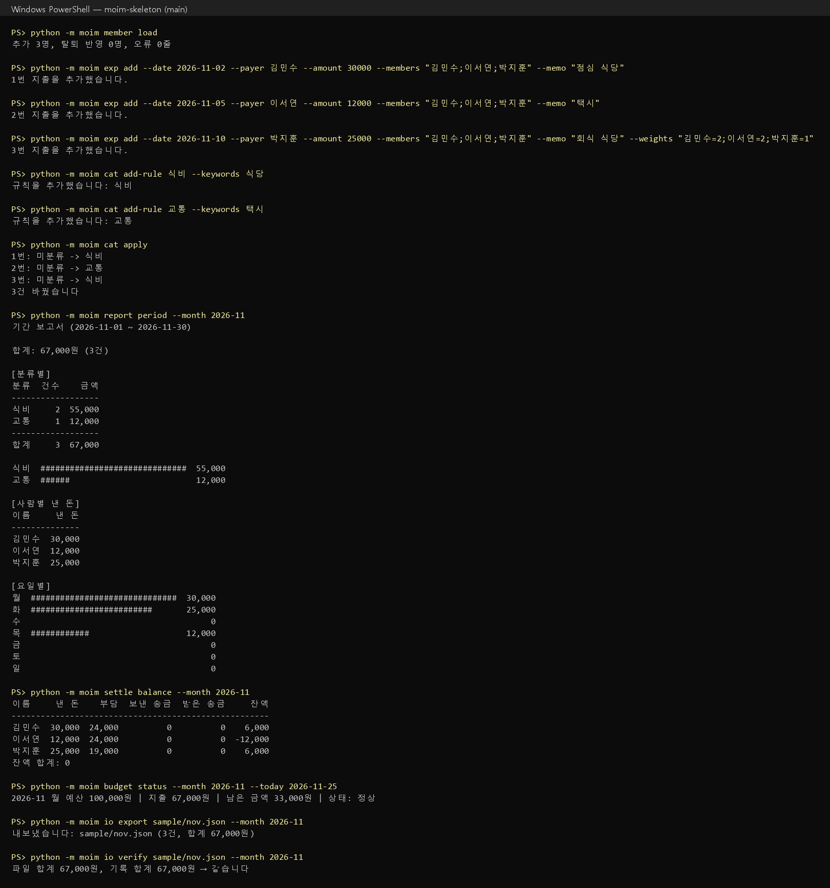

# 2팀 중간발표 — 모임 회비·지출 정산 도구

11/24 23:59 main(`c8a7684`) 기준 · 발표 11/25(수) 09:30 · 점검 기준은 **11/24(화) 23:59 의 main**
기준 문서: `docs/규격합의_기능별.md` · `docs/협업규칙.md` · `docs/역할.md`

발표 순서(5분): 1. 기본 필수 구현 결과 → 2. 통합 실행 화면 → 3. 공통 모듈 현황 → 4. 프로젝트 이슈 → 5. 12/1 까지의 계획

---

## 1. 기본 필수 구현 결과

표의 번호는 main 에 병합된 병합 요청(PR) 번호. **기본 필수 24개(6개 기능 × 4개) 모두 main 에 병합됨** — 마지막은 기능 6 JSON 내보내기(#133, 11/24)

### 기능 1. 지출 입력·관리 — 이승경

| 기본 필수 | 병합 요청 | 상태 |
|---|---|---|
| 지출 추가(날짜, 낸 사람, 금액, 참여자, 메모, 사람별 비율) | #53 `ledger.validate`·`insert`, #81 `add_expense`, #82 `exp add` | ✅ |
| 지출 목록 보기(번호순, 날짜순) | #81 `list_expenses`, #82 `exp list --order` | ✅ |
| 지출 수정과 삭제(번호로 지정, 삭제는 삭제 표시) | #81 `edit_expense`·`delete_expense`, #82 `exp edit`·`exp delete` | ✅ |
| 입력 검증(음수·0원, 없는 날짜, 빈 참여자, 명부에 없는 사람) | #53 `ledger.validate` | ✅ |

### 기능 2. 분류 규칙 — 백지윤

| 기본 필수 | 병합 요청 | 상태 |
|---|---|---|
| 메모의 키워드로 지출 분류 | #43 `classify`·`apply_rules` | ✅ |
| 분류 규칙을 JSON 파일로 저장하고 읽기 | #43 `save_rules`·`load_rules` | ✅ |
| 규칙 추가·삭제·목록 명령 | #58 `cat add-rule`·`remove-rule`·`rules` | ✅ |
| 분류되지 않은 지출 목록 | #43 `uncategorized`, #58 `cat uncategorized` | ✅ |

### 기능 3. 월별·기간 보고서 — 류훈태

| 기본 필수 | 병합 요청 | 상태 |
|---|---|---|
| 월별 지출 합계 | #63 `monthly_totals`, #103 `report monthly` | ✅ |
| 기간을 지정한 합계 | #63 `period_summary`(#69 `period_total` 사용), #103 `report period` | ✅ |
| 분류별 합계 | #63 `period_summary`(#39 `category_totals` 사용), #103 | ✅ |
| 사람별(낸 돈 기준) 합계 | #52 `person_paid`, #63, #103 | ✅ |

### 기능 4. 정산 — 김영광

| 기본 필수 | 병합 요청 | 상태 |
|---|---|---|
| 사람마다 낸 돈, 부담할 돈, 잔액 | #66 `balances`(#28 `expense_shares`, #59 `member_shares` 사용), #78 `settle balance` | ✅ |
| 나머지 1원 배분은 규약 문서의 방법 | #10 `money.split` | ✅ |
| 정산 기간 지정 | #66, #78 `--month` 또는 `--start`·`--end` | ✅ |
| 모든 사람의 잔액 합이 0인지 검사 | #49 `balance_sum`, #78 (0 이 아니면 경고) | ✅ |

### 기능 5. 예산·회비 — 이정배

| 기본 필수 | 병합 요청 | 상태 |
|---|---|---|
| 월 예산 설정(설정 파일) | #46 설정 항목 `budget.monthly`(설정 파일 담당), #91 `month_status` | ✅ |
| 이번 달 예산 초과 여부와 남은 금액 | #91 `month_status`, #100 `budget status` | ✅ |
| 회비 입금 기록(누가 언제 얼마) | #41 `payments` 항목, #55 `record_payment`, #100 `budget pay` | ✅ |
| 모임 통장 잔고(입금 합계 − 지출 합계) | #92 `treasury_balance`, #100 `budget balance` | ✅ |

### 기능 6. 가져오기·내보내기 — 류강현

| 기본 필수 | 병합 요청 | 상태 |
|---|---|---|
| CSV 로 내보내기(엑셀에서 한글이 깨지지 않게) | #97 `export_csv`(UTF-8 BOM), #133 `io export 파일.csv` | ✅ |
| JSON 으로 내보내기 | #99·#126 규격, #133 `export_json`·`io export 파일.json` | ✅ |
| 기간·분류를 골라서 내보내기 | #97 `export_csv(start, end, category)`, #133 `--month`·`--start`·`--end`·`--category` | ✅ |
| 내보낸 파일 합계 검사 | #72 `file_total`, #111, #112 `verify_export`, #133 `io verify` | ✅ |

모든 PR 은 팀원 1명 이상 승인 뒤 병합(main 보호 규칙: 승인 1명·check 통과·force push 금지·우회 없음).

---

## 2. 통합 실행 화면

main 그대로, 빈 폴더에서 설정 파일(`config.json`)과 명부 파일(`members.txt`)만 두고 실행한 결과.



<details>
<summary>실행한 명령과 출력(텍스트)</summary>

```
$ python -m moim member load
추가 3명, 탈퇴 반영 0명, 오류 0줄

$ python -m moim exp add --date 2026-11-02 --payer 김민수 --amount 30000 --members "김민수;이서연;박지훈" --memo "점심 식당"
1번 지출을 추가했습니다.
$ python -m moim exp add --date 2026-11-05 --payer 이서연 --amount 12000 --members "김민수;이서연;박지훈" --memo "택시"
2번 지출을 추가했습니다.
$ python -m moim exp add --date 2026-11-10 --payer 박지훈 --amount 25000 --members "김민수;이서연;박지훈" --memo "회식 식당" --weights "김민수=2;이서연=2;박지훈=1"
3번 지출을 추가했습니다.

$ python -m moim cat add-rule 식비 --keywords 식당
규칙을 추가했습니다: 식비
$ python -m moim cat add-rule 교통 --keywords 택시
규칙을 추가했습니다: 교통
$ python -m moim cat apply
1번: 미분류 -> 식비
2번: 미분류 -> 교통
3번: 미분류 -> 식비
3건 바꿨습니다

$ python -m moim report period --month 2026-11
기간 보고서 (2026-11-01 ~ 2026-11-30)

합계: 67,000원 (3건)

[분류별]
분류  건수    금액
------------------
식비     2  55,000
교통     1  12,000
------------------
합계     3  67,000

$ python -m moim settle balance --month 2026-11
이름     낸 돈    부담  보낸 송금  받은 송금     잔액
-----------------------------------------------------
김민수  30,000  24,000          0          0    6,000
이서연  12,000  24,000          0          0  -12,000
박지훈  25,000  19,000          0          0    6,000
잔액 합계: 0

$ python -m moim budget status --month 2026-11 --today 2026-11-25
2026-11 월 예산 100,000원 | 지출 67,000원 | 남은 금액 33,000원 | 상태: 정상

$ python -m moim io export sample/nov.json --month 2026-11
내보냈습니다: sample/nov.json (3건, 합계 67,000원)
$ python -m moim io verify sample/nov.json --month 2026-11
파일 합계 67,000원, 기록 합계 67,000원 → 같습니다
```

</details>

보여 주는 것: 명부(설정 파일) → 입력(1) → 분류(2) → 보고서(3) → 정산(4, 비율 2:2:1·잔액 합 0) → 예산(5) → 내보내기·합계 검사(6). 보고서 합계 67,000 = 정산 낸 돈 합 = 예산 지출 = 내보낸 파일 합계.

---

## 3. 공통 모듈 현황 (`moim/common`)

| 공통 함수·자료 항목 | 구현 담당 | 병합 요청 |
|---|---|---|
| `ledger.validate`·`insert`(지출 검사·저장), `Store.record`·`history`(변경 이력) | 이승경(기능 1) | #53, #48 |
| `queries.category_of`·`category_totals`(분류 조회), 설정 파일 항목 | 백지윤(기능 2·설정 파일) | #39, #46 |
| `queries.expenses_in`·`person_paid`, `textfmt.table`·`bar_chart` | 류훈태(기능 3) | #40, #52, #54, #62 |
| `queries.is_locked`·`expense_shares`·`member_shares`, `money.split` 비율 분배, `locks`·`transfers`·`recurring` 항목 | 김영광(기능 4) | #7, #10, #28, #59 |
| `queries.is_member_active`·`active_members`, `dates.months_between`, `payments` 항목, 안전 저장·백업·복구 | 이정배(기능 5·손상 대응) | #16, #29, #34, #41, #37 |
| `queries.period_total`, `dates.month_key`, `ledger.duplicates`, `csvio.detect_encoding`·`read_csv_rows`, 날짜별 로그 | 류강현(기능 6·로그) | #69, #64, #56, #42, #71, #70 |

- 스켈레톤의 공통 함수 이름·인자는 그대로 두고 새 함수·항목만 추가함. 공통 모듈 PR 설명에 "바꾼 공통 모듈 · 쓰는 기능" 표를 적음
- 공통 모듈 PR(병합 기준): 류강현 6 · 이정배 5 · 김영광 4 · 류훈태 4 · 이승경 2 · 백지윤 2 → **모두 2건 이상**
- 다른 사람 PR 검토(11/24 기준, PR 수): 김영광 84 · 이승경 30 · 백지윤 25 · 이정배 24 · 류강현 22 · 류훈태 7 → **모두 5건 이상**

---

## 4. 프로젝트 이슈 (해결한 것 포함)

| # | 구분 | 발생 위치 | 원인 · 영향 | 해결 / 계획 |
|---|---|---|---|---|
| 1 | 협업 | PR #18 → `moim/common/ledger.py` `duplicates` | 연습용 PR 에 공통 함수 변경이 섞여 병합됨 · 기능 1 중복 경고가 쓰는 함수가 바뀜 | #32 에서 `git revert -m 1` 로 되돌림(강제 덮어쓰기 없이). 이후 #56 으로 다시 구현 |
| 2 | 협업 | PR #87 → #88 (`settle transfer` 명령) | #88 이 #87 위에 쌓인 PR 인데 base 를 main 으로 바꾸지 않고 병합 · main 에 반영 안 됨 | 같은 커밋을 main 기준 #116 으로 다시 올려 승인 뒤 병합(11/23). 쌓인 PR 은 병합 전 base 확인 |
| 3 | 구현 | PR #99 `merge` 반환값(규격 6-2 6번) | 검토 의견이 "추가 건수 + 건너뛴 목록"을 묶어 돌려주게 유도 · 스켈레톤 docstring("합친 지출 수")과 어긋남 | 검토자가 정정 의견을 남기고 정수 반환으로 수정, 건너뛴 목록은 `report=None`·명령 출력으로(5a42860) |
| 4 | 구현 | PR #113 `transfer_io.roundtrip_check` | 대조할 파일을 함수가 다시 내보내 덮어씀, 번호를 문자열로 돌려줌 · 바뀐 파일을 찾지 못함 | 0cab1ec 에서 읽기만 하고 정수 반환으로 수정. #111·#112 와 같은 테스트 파일이라 충돌 → b3ed6c9 에서 main 을 받아 해결, 11/24 병합 |
| 5 | 일정·환경 | #111(3007a17, b9a70a7), #112(56f3e38), #115·#118·#120·#122~#126(검토 의견 반영 커밋) | 승인 뒤 커밋이 다시 검토 없이 병합됨 · 저장소 규칙의 `dismiss_stale_reviews` 가 꺼져 있음(설정은 공고문상 바꾸지 않음) | 계획: 승인 뒤 커밋하면 다시 검토를 요청하는 규칙을 협업 규칙에 추가하고, 세 커밋은 사후 검토(김영광, 11/24) |
| 6 | 구현 | `load_members_file` vs `leave_member`(#119) | `member load` 는 탈퇴일 뒤 지출을 검사하지 않아 `member leave` 로는 막히는 탈퇴가 통과 · 규약 6-2 위반 자료 가능 | 공고문 4쪽·규약 6-2 근거로 같은 규칙 적용, #127 병합(백지윤, 기능 1 승인) |
| 7 | 구현 | PR #85 `settle.add_recurring` | `0000-11` 같은 0년 달을 받아 저장한 뒤 `run_recurring` 이 날짜를 만들다 실패 · 다른 반복 지출까지 멈춤 | 검토 의견으로 연도 1~9999 검사 추가, 테스트 3개(894fcc5) |
| 8 | 구현 | 로그(#70) ↔ 통합 실행 `moim/cli.py` | 날짜별 로그 함수는 병합됐지만 통합 실행이 부르지 않음 · 명령을 실행해도 로그 파일이 생기지 않음 | 류강현·이승경이 `cli.main` 에 연결, 12/1 전 |
| 9 | 일정 | `ledger.insert`(#53), `add_expense`(#81) | 다른 다섯 기능의 테스트가 지출 추가를 기다림(제안발표에서 예측한 병목) | 11/19 #53 병합 뒤 각 기능은 테스트에서 자료를 직접 넣어 먼저 진행 |
| 10 | 구현 | `budget.month_status`·`category_status`(#91, #93) | 경고 기준을 `>=`(80% 이상)로 구현 · 공고문은 "80%를 넘으면(80% 초과)" — 규약 해석 차이 | #131 에서 `>` 로 고치고 80%·80%+1원 경계 테스트 추가, README 문구는 #136 |
| 11 | 협업 | PR #133(`export_json`·`io` 명령) | #113 브랜치 위에서 만들어 PR 화면이 445줄·변경 두 가지로 보임(300줄 규칙), 제목·필수 표 누락 | #113 을 먼저 병합해 실제 변경 166줄로 줄이고, 관리자가 제목·표를 규칙 형식으로 정리한 뒤 병합(11/24) |
| 12 | 구현 | PR #138 `transfer_io.merge` | 백업 파일의 회원을 검사하지 않아 가입일 없는 회원이 들어가면 `active_members`·`budget unpaid` 가 `KeyError` 로 멈춤 | Request changes(11/24). 회원 가입일·탈퇴일 검사 후 `report` 로 보고하도록 수정(류강현, 12/1 전) |

---

## 5. 12월 1일까지의 계획

기능마다 확장 필수 4개 + 선택 2개 이상. 상태는 11/24 23:59 main 기준(✅ 병합 · 🟡 승인됨·병합 대기 · 🔧 진행 중 · ⬜ 시작 전)

| 기능 | 확장 필수 | 선택 |
|---|---|---|
| 1 이승경 | 명부 관리 #118 #119 #120 #127 ✅ · 이력 #48 #123 ✅ · 여러 줄 입력 #124 ✅ · 중복 의심 경고 ⬜ | 되살리기 #121 ✅ · 되돌리기 #122 ✅ · 삭제 포함 목록(함수 #81✅, 명령 ⬜) |
| 2 백지윤 | 우선순위 · 다시 분류 · 직접 지정 · 분류별 집계 #39 #43 #58 ✅ | 낸 사람·금액 규칙 · 겹침 검사 · 미리 보기 #43 #58 ✅ |
| 3 류훈태 | 전월 대비 #65 #104 · 표 #54 · 막대그래프 #62 · 검색 #84 #104 ✅ | 요일·주별 #65 #107 · 상위 N·가장 많이 쓴 날 #84 #101 #107 · 보고서 저장 #101 #107 ✅ |
| 4 김영광 | 최소 송금 #74 · 가중치 #10 #28 · 반복 지출 #85 · 정산 확정 #77 #87 ✅(함수) · 최소 송금·반복 지출 명령 ⬜ | 송금 기록 #76 #116 ✅ · 내역서 #89 · 사람 빼기 #90 · 이전 정산 비교 #75 ✅(함수, 명령 ⬜) |
| 5 이정배 | 분류별 예산 #93 #115 ✅ · 80% 경보 #91 #93 #131 ✅ · 미납자 #61 #115 ✅ · 은행 거래내역 가져오기 #130 ✅(함수, `budget import-bank` 명령 ⬜) | 월말 예측 #94 · 예산 대비 실제 #95 · 회비 차감 #73 ✅ · 다음 달 예산 제안 ⬜ |
| 6 류강현 | CSV 가져오기 #134 ✅ · 인코딩 판별 #42 #71 ✅ · 중복·오류 행 보고 #134 #143 ✅ · 다른 모임 자료 합치기 #138🔧(규격 #99✅) | 백업·복원 #105 #139 ✅ · 다시 읽어 대조 #113 #139 ✅ · 가져오기 미리 보기 #134 ✅ |

팀 공동 작업: 통합 실행 `init` #125 ✅(이승경) · 로그 연결 ⬜(류강현) · 사용 설명서 report #106 #109 · cat #108 · exp #132 #140 · settle #135 · budget #110 #136 · member #137 · io #141 · init #142 ✅, io backup·restore·total·roundtrip 절 ⬜(류훈태) · 통합 시나리오 테스트 #117🟡(김영광, 기능 1 함수로 보강해 병합)

### 병합 순서

1. **11/24** (완료) — #113 → #133 순서로 기능 6 기본 필수 병합, 승인된 기능 1·5 PR(#115, #118, #120~#127, #130, #131) 병합, 기능 6 `import_csv`(#134)·중복 처리 규격(#143)·`io` backup·restore·total·roundtrip 명령(#139), README #135~#137·#140~#142
2. **11/25~11/27** — 기능 6 `merge`(#138) → `io import`·`io merge` 명령 · 기능 1 중복 의심 경고(#56 `duplicates` 사용) · 기능 5 `budget import-bank` 명령
3. **11/28~11/30** — 기능 4 명령(최소 송금·반복 지출·내역서·비교) · 로그 연결 · #117 통합 시나리오 보강(`add_member`·`import_csv`·`merge`) 뒤 병합
4. **12/1 23:59** — 사용 설명서 마무리, 최종 병합. 공통 모듈 변경 이력 감사 보고서(팀장, LMS PDF) · 개인 기여 요약(각자, LMS)
